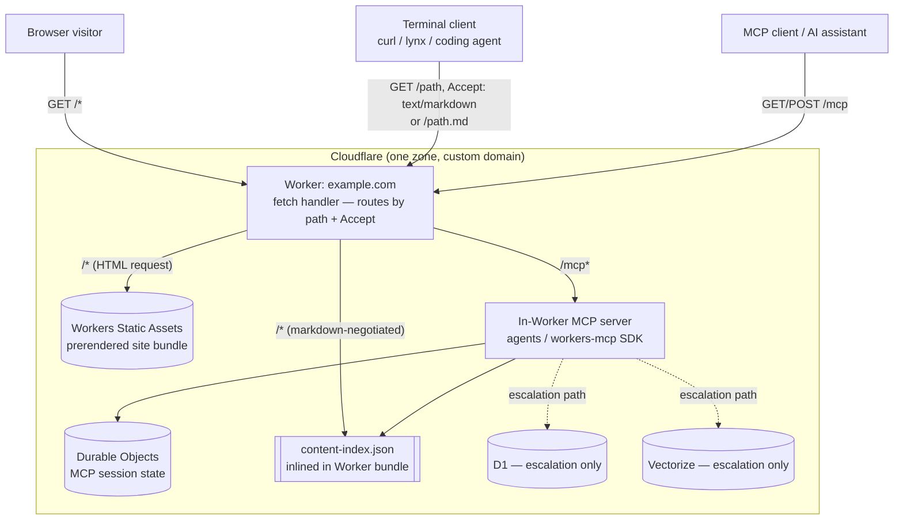
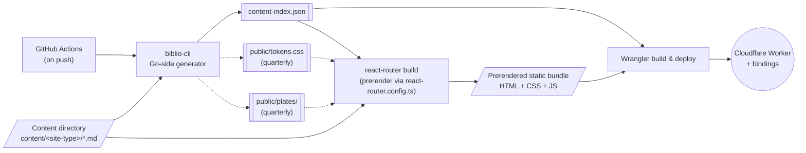
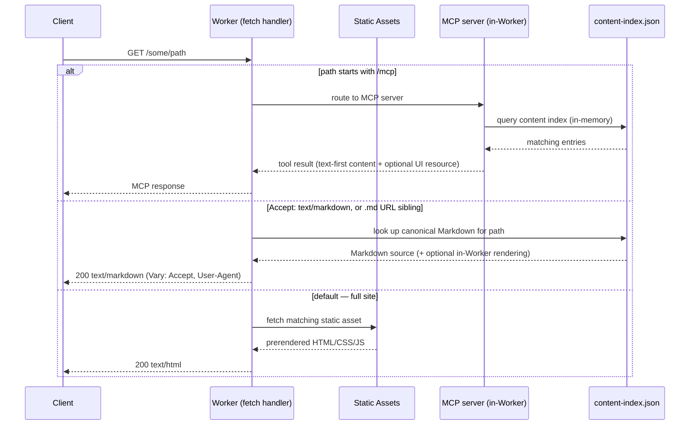
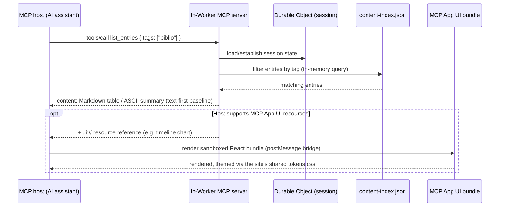
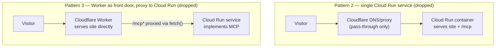
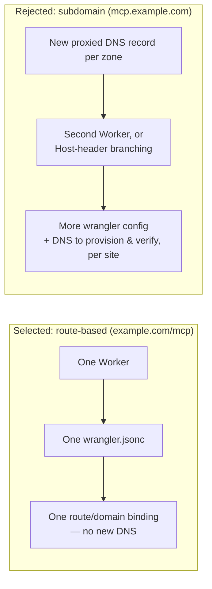

# Architecture: `biblio` platform — reference diagrams

Reference diagrams for the `biblio` architecture selected in [001-static-site-platform-with-mcp.md](001-static-site-platform-with-mcp.md) — see that document for the research and rationale behind these decisions, and the [Decision Log](001-static-site-platform-with-mcp.md#decision-log) for exact wording of each confirmed decision.

## 1. High-level architecture (selected)

A single Cloudflare Worker is the **one public origin** for a `biblio` site: it serves the prerendered React + Vite static build *and* implements the `/mcp` endpoint in-Worker, on one domain/host with no cross-origin boundary.

**Why this shape:** the site and `/mcp` share one domain/host (no CORS to manage), one deploy, one set of bindings — the simplest topology to scaffold and replicate across many sites. See §5 below for the alternative patterns that were evaluated and dropped.

## 2. Build & deployment pipeline

Three build steps run in order, normally triggered by a push via GitHub Actions:

0. **Pre-build step inside `biblio-cli build`/`dev`** *(planned, [§11](roadmap.md#11-quarterly-site-type), [004](004-quarterly-site-type.md#build-pipeline-changes))* — for every site type, validate `content/site.yaml` and run step 1 automatically, so `index` no longer has to be run by hand. For `quarterly` sites only, it also regenerates `public/tokens.css` from the preset plus the validated `typesetting:` overrides, and writes grayscale, width-capped copies of content images to `public/plates/` (dashed edges above). Order: validate → tokens → plates → index. Draft issues are left out of the index on `build` and kept on `dev`.
1. **`biblio-cli` generates `content-index.json`** — a Go-side generator parses every Markdown file's frontmatter + body (mirroring what `gray-matter` would do in JS) into a single canonical artifact, the source of truth for both the site build and the MCP server.
2. **`react-router build`** — the framework's native `prerender` (configured in `react-router.config.ts`, driven by an async function that enumerates content-driven routes from the content index) renders every route to static HTML/CSS/JS.
3. **Wrangler build & deploy** — the Worker `import`s `content-index.json` directly (inlined into its V8 bundle for in-memory querying, no extra fetch at runtime) and binds the prerendered output as static assets, then publishes both to Cloudflare.

## 3. Request routing call flow (in-Worker `fetch` handler)

This single branch point in the `fetch` handler is what lets `biblio` serve three audiences (browsers, MCP clients, terminal/agent clients) from one Worker, one deploy, one origin — see [001 → terminal/CLI-optimized view](001-static-site-platform-with-mcp.md#architecture-patterns) for the content-negotiation research behind the middle branch.

## 4. MCP tool-call flow (e.g., `list_entries` on a project-log site)

The text-first `content` is always returned — terminal-based hosts stop there; graphical hosts additionally get the richer UI resource. See [001 → MCP App UI rendering](001-static-site-platform-with-mcp.md#architecture-patterns) for the confirmed rationale.

The planned `quarterly` type ([§11](roadmap.md#11-quarterly-site-type)) follows the same flow with its own tools (`list_issues`, `get_issue`, `list_articles`, `get_article`). `get_article` returns footnotes and margin notes as structured lists alongside the text, read from the content index rather than parsed per request (pending the §0.5 structured-notes decision).

## 5. Patterns considered (and dropped)

For traceability — these were evaluated against the selected pattern (§1) and dropped; see the [Decision Log](001-static-site-platform-with-mcp.md#decision-log) for the full rationale.

- **Pattern 2** moves static-asset serving off Cloudflare's free edge onto paid Cloud Run compute, reducing Cloudflare to a thin pass-through for domain/TLS/caching only.
- **Pattern 3** keeps "both/either" backend flexibility but doubles the deployables-per-site (Worker *and* Cloud Run service) and adds proxy/streaming-transparency complexity — more moving parts than `biblio`'s personal/portfolio scale calls for.

## 6. Route vs. subdomain for `/mcp` (within the selected pattern)

The route-based split needs no extra DNS work and keeps `biblio-cli` scaffolding to one project/one deploy — strictly simpler to replicate across many sites. CORS, the original concern that motivated considering a subdomain, doesn't actually apply: MCP clients connect directly as external HTTP/SSE clients rather than through the site's own browser JS.

## References

- [001-static-site-platform-with-mcp.md](001-static-site-platform-with-mcp.md) — research and decisions behind every diagram on this page
- [deployment-guide.md](deployment-guide.md) — the end-to-end guide to creating, configuring, and deploying a site on this architecture
- [roadmap.md](roadmap.md) — the implementation task breakdown that builds this architecture out
- [004-quarterly-site-type.md](004-quarterly-site-type.md) — the pre-build step (§2 step 0) and the fourth site type
